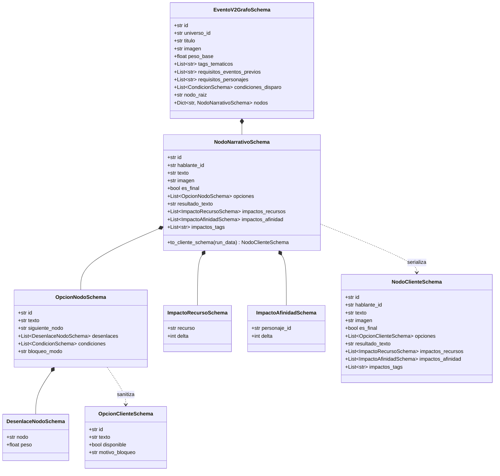
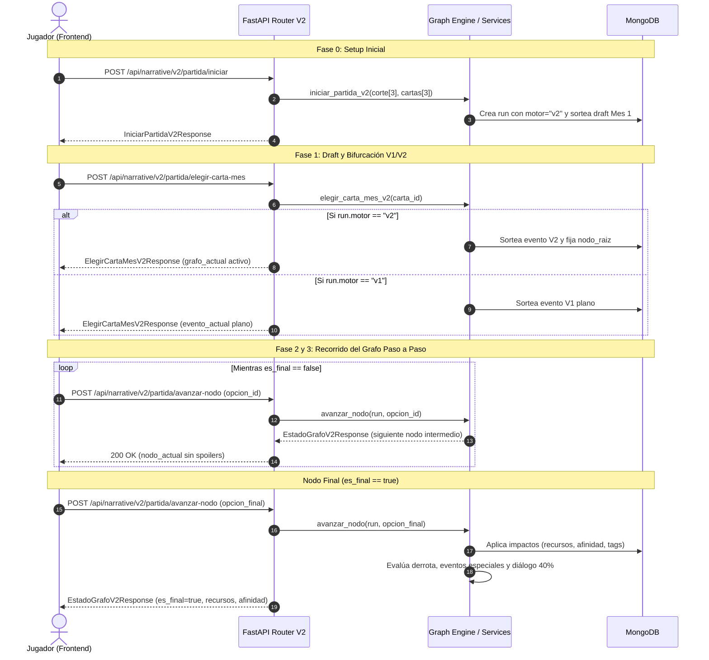

# Documentación Técnica: Motor de Grafos Narrativo V2

> **Módulo:** `app/features/narrative`  
> **Versión del Motor:** 2.0 (Basado en Grafos de Decisión y Árboles Ponderados)  
> **Estado:** En producción  
> **Compatibilidad:** Retrocompatible con universos del Motor V1 (Híbrido)  
> **Fecha de Actualización:** Octubre 2026  

---

## 1. Resumen Ejecutivo: Motor de Grafos V2 vs Motor Lineal V1

El sistema de juego narrativo (*KingsCourt*) evolucionó desde un modelo plano de resolución inmediata (**Motor V1**) hacia un motor genérico y desacoplado basado en grafos dirigidos de decisión (**Motor V2**). Esta transformación resuelve problemas arquitectónicos críticos de escalabilidad, rejugabilidad, rigidez narrativa y experiencia de usuario.

```
┌────────────────────────────────────────────────────────────────────────────────────────┐
│                                 DIFERENCIA DE ARQUITECTURA                             │
├────────────────────────────────────────────────────┬───────────────────────────────────┤
│                     MOTOR V1                       │             MOTOR V2              │
│                 (Resolución Plana)                 │        (Grafo de Decisión)        │
├────────────────────────────────────────────────────┼───────────────────────────────────┤
│                                                    │            [Nodo Raíz]            │
│               [Evento Mensual]                     │            /         \            │
│              /        |       \                    │        [Opción A]   [Opción B]    │
│         [Opción A] [Opción B] [Opción C]           │           /             \         │
│             │         │          │                 │     [Nodo Intermedio] [Nodo Final]│
│         (1 Tirada / Probabilidades Expuestas)      │         /       \                 │
│             │                                      │     [Opción 1] [Opción 2]         │
│      [Resultado en Colección Externa]              │         │           │             │
│                                                    │    [Nodo Final A] [Nodo Final B]  │
│                                                    │   (Impactos inline en terminales) │
└────────────────────────────────────────────────────┴───────────────────────────────────┘
```

### 1.1. Principios de Arquitectura V2

1. **Topología en Árbol vs. Resolución One-Shot:**
   - **En V1**, el jugador recibía un evento con 3 opciones fijas. Al elegir una, el backend realizaba una única tirada ponderada (`decidir-evento`) que devolvía un documento de resultado externo (`narrative_results`) y calculaba los deltas de una vez.
   - **En V2**, los eventos y conversaciones son **grafos navegables**. El usuario recorre $N$ pasos (`avanzar-nodo`) a través de nodos intermedios con diálogos de consejeros o dilemas morales antes de alcanzar una hoja terminal (`es_final: true`).

2. **Modelo Unificado y Agnóstico:**
   - En V1, los eventos (`narrative_events`) y las conversaciones (`narrative_conversations`) tenían esquemas radicalmente incompatibles: los eventos usaban opciones vinculadas a IDs de resultados externos, mientras que las conversaciones usaban un array plano de `frases[]` y un array de `decisiones[]` indexadas numéricamente (`opcion_numero: 1`).
   - En V2, **Eventos**, **Conversaciones** y **Eventos Especiales de Afinidad** comparten el mismo motor de recorrido ([`GraphTraversalEngine`](file:///c:/Users/nmonti/Desktop/proyectos/backend/mayores_actualizacionesSIPI-BACK/app/features/narrative/engine/graph_engine.py#L35-L528)) y el mismo formato de nodo ([`NodoNarrativoSchema`](file:///c:/Users/nmonti/Desktop/proyectos/backend/mayores_actualizacionesSIPI-BACK/app/features/narrative/schemas/v2_graph_schemas.py#L49-L136)). Ambos se avanzan con el mismo endpoint HTTP (`avanzar-nodo`).

3. **Desacoplamiento y Supresión de Colecciones Intermedias:**
   - En V1 existía la colección `narrative_results`. Los eventos requerían que cada opción apuntara a un `resultado_id`, obligando a mantener decenas de documentos pequeños sueltos en base de datos.
   - En V2, los impactos en recursos (`impactos_recursos`), afinidad (`impactos_afinidad`), tags permanentes (`impactos_tags`) y el texto de conclusión (`resultado_texto`) viven **inline en el nodo terminal**. La entidad grafo es 100% autocontenida.

4. **Filosofía Anti-Spoiler y Sanitización Estricta:**
   - En V1, el backend enviaba al frontend el array completo de desenlaces posibles con sus porcentajes calculados (`probabilidades: [{ titulo, porcentaje: 66.7 }]`), restando tensión dramática e inmersión.
   - En V2, el método [`to_cliente_schema()`](file:///c:/Users/nmonti/Desktop/proyectos/backend/mayores_actualizacionesSIPI-BACK/app/features/narrative/schemas/v2_graph_schemas.py#L95-L136) depura completamente la información del servidor:
     - Nunca expone `siguiente_nodo`.
     - Nunca expone el array de `desenlaces` ni sus pesos.
     - Si el nodo es intermedio (`es_final: false`), oculta cualquier impacto futuro o texto de cierre.

5. **Reactividad de Opciones (Candados y Ramas Ocultas):**
   - Las opciones en V2 evalúan una lista de condiciones (`condiciones: List[CondicionSchema]`) contra el estado vivo de la partida (`recursos`, `afinidad`, `tags`, `cartas_en_mano`).
   - Si no cumple los requisitos, el campo `bloqueo_modo` define el comportamiento:
     - `"deshabilitada"`: El cliente recibe `disponible: false` junto a un `motivo_bloqueo` legible (ej: *"Requiere Oro >= 80"* o *"Requiere a Canciller Elena en la corte"*).
     - `"oculta"`: La opción se elimina directamente de la lista entregada al cliente (ramas secretas para jugadores perspicaces).

6. **Desenlaces Ponderados por Suerte/Tirada:**
   - Una opción no está atada a un destino único: puede definir `desenlaces: List[DesenlaceNodoSchema]`. Al pulsar la opción, el backend sortea el destino mediante `random.choices` respetando los pesos relativos (ej. 70/30).

7. **Arcos Narrativos y Sinergias Orgánicas:**
   - Los eventos V2 soportan `requisitos_eventos_previos`. Un evento de secuela (ej. *"La Herejía de la Secta del Cometa"*) solo ingresará al pool de sorteo si el jugador ya completó el evento raíz (*"El Cometa de la Frontera"*).
   - El algoritmo de sorteo pondera la aparición de eventos multiplicando el peso base según afinidad de corte ($\times 2.0$), cartas en inventario ($\times 2.5$) y recursos en situación de crisis $< 25$ ($\times 3.0$).

8. **Eventos Especiales de Umbral de Afinidad (Lealtad y Traición):**
   - Cuando una decisión en un nodo final provoca que la afinidad de un consejero alcance o supere $95$ (`AFINIDAD_UMBRAL_LEALTAD`) o caiga por debajo de $15$ (`AFINIDAD_UMBRAL_TRAICION`), el motor interrumpe el flujo normal y encadena de inmediato un grafo de evento especial de lealtad o traición.

---

## 2. Estructura de Datos del Grafo (Modelos Pydantic)

Ubicación del código fuente: [`app/features/narrative/schemas/v2_graph_schemas.py`](file:///c:/Users/nmonti/Desktop/proyectos/backend/mayores_actualizacionesSIPI-BACK/app/features/narrative/schemas/v2_graph_schemas.py).



### 2.1. Modelos de Impactos y Desenlaces

#### `ImpactoRecursoSchema`
Representa una variación entera en uno de los recursos vitales del reino al concluir un nodo final:
```python
class ImpactoRecursoSchema(BaseModel):
    recurso: str = Field(..., description="Clave del recurso modificado (oro, pueblo, ejercito, fe)")
    delta: int = Field(..., description="Variación entera positiva o negativa (+20, -15)")
```

#### `ImpactoAfinidadSchema`
Representa una variación entera en el nivel de simpatía o lealtad de un consejero de corte:
```python
class ImpactoAfinidadSchema(BaseModel):
    personaje_id: str = Field(..., description="ID del personaje de corte afectado (ej: pj_canciller_elena)")
    delta: int = Field(..., description="Variación entera de afinidad (+15, -10)")
```

#### `DesenlaceNodoSchema`
Permite definir múltiples posibles nodos de destino para una misma opción, resueltos mediante sorteo estocástico ponderado en el servidor:
```python
class DesenlaceNodoSchema(BaseModel):
    nodo: str = Field(..., description="ID del nodo destino posible de la opción")
    peso: float = Field(default=1.0, description="Peso relativo del desenlace para el sorteo ponderado")
```

### 2.2. Modelos de Opciones

#### `OpcionNodoSchema` (Esquema Servidor / Almacenamiento)
```python
class OpcionNodoSchema(BaseModel):
    id: str = Field(..., description="Identificador único de la opción (ej: opt_1, opt_apoyar_marcus)")
    texto: str = Field(..., description="Texto visible en el botón de decisión para el jugador")
    siguiente_nodo: Optional[str] = Field(
        default=None,
        description="ID del nodo destino fijo. Usado si 'desenlaces' está vacío."
    )
    desenlaces: List[DesenlaceNodoSchema] = Field(
        default_factory=list,
        description="Desenlaces ponderados opcionales: la opción sortea un destino según pesos (ej: 40/60)"
    )
    condiciones: List[CondicionSchema] = Field(
        default_factory=list,
        description="Condiciones de estado (recursos, afinidad, personajes, cartas, tags) requeridas"
    )
    bloqueo_modo: str = Field(
        default="deshabilitada",
        description="'deshabilitada' (se muestra bloqueada con motivo) u 'oculta' (opción secreta no visible si no cumple)"
    )
```

#### `OpcionClienteSchema` (Esquema Sanitizado Cliente)
Es la versión entregada a la interfaz web o móvil tras evaluar la reactividad del estado:
```python
class OpcionClienteSchema(BaseModel):
    id: str = Field(..., description="Identificador de la opción seleccionable")
    texto: str = Field(..., description="Texto que el usuario lee en el botón")
    disponible: bool = Field(default=True, description="True si cumple todos los requisitos para ser seleccionada")
    motivo_bloqueo: Optional[str] = Field(default=None, description="Texto explicativo para el jugador si la opción está bloqueada")
```

### 2.3. Modelos de Nodos

#### `NodoNarrativoSchema` (Esquema Interno del Grafo)
```python
class NodoNarrativoSchema(BaseModel):
    id: str = Field(..., description="ID único del nodo dentro del grafo")
    hablante_id: str = Field(..., description="ID del orador ('narrador' para eventos, o ID de personaje como 'pj_elena')")
    texto: str = Field(..., description="Diálogo o narración correspondiente a este paso")
    imagen: Optional[str] = Field(default=None, description="Imagen ilustrativa opcional del nodo")
    es_final: bool = Field(default=False, description="True si es una hoja de desenlace que concluye el grafo")
    opciones: List[OpcionNodoSchema] = Field(default_factory=list, description="Opciones disponibles si no es final")
    resultado_texto: str = Field(default="", description="Texto de consecuencia y cierre si es_final=True")
    impactos_recursos: List[ImpactoRecursoSchema] = Field(default_factory=list, description="Impactos en recursos si es_final=True")
    impactos_afinidad: List[ImpactoAfinidadSchema] = Field(default_factory=list, description="Impactos en afinidad si es_final=True")
    impactos_tags: List[str] = Field(default_factory=list, description="Tags permanentes otorgados al reino si es_final=True")
```

#### `NodoClienteSchema` (Esquema Sanitizado Cliente)
Generado por el método `to_cliente_schema(run_data)`:
```python
class NodoClienteSchema(BaseModel):
    id: str
    hablante_id: str
    texto: str
    imagen: Optional[str] = None
    es_final: bool = False
    opciones: List[OpcionClienteSchema] = Field(default_factory=list)
    resultado_texto: str = ""
    impactos_recursos: List[ImpactoRecursoSchema] = Field(default_factory=list)
    impactos_afinidad: List[ImpactoAfinidadSchema] = Field(default_factory=list)
    impactos_tags: List[str] = Field(default_factory=list)
```

> [!IMPORTANT]
> **Lógica Anti-Spoilers de `to_cliente_schema`:**
> Si `es_final == False`, los campos `resultado_texto`, `impactos_recursos`, `impactos_afinidad` e `impactos_tags` se devuelven vacíos/limpios, impidiendo que el cliente descubra desenlaces o examine consecuencias por inspección del tráfico HTTP.

### 2.4. Esquema de Condiciones (`CondicionSchema`)

Proviene de [`app/features/narrative/schemas/rules_schemas.py`](file:///c:/Users/nmonti/Desktop/proyectos/backend/mayores_actualizacionesSIPI-BACK\app\features\narrative\schemas\rules_schemas.py):
```python
class CondicionSchema(BaseModel):
    tipo: TipoCondicionEnum
    clave: Optional[str] = None             # Nombre del recurso (ej: "oro", "pueblo")
    operador: Optional[OperadorEnum] = None # ">=", "<=", ">", "<", "==", "!="
    valor: Optional[Union[int, float, str]] = None
    personaje_id: Optional[str] = None      # Para "tiene_personaje" o "afinidad_personaje"
    carta_id: Optional[str] = None          # Para "tiene_carta"
    tag: Optional[str] = None               # Para "tiene_tag"
```

Valores soportados por `TipoCondicionEnum`:
- `"comparar_recurso"`: Evalúa `recursos[clave] (operador) valor`.
- `"tiene_personaje"`: Verifica que `personaje_id` esté en la corte activa.
- `"afinidad_personaje"`: Evalúa `afinidad[personaje_id] (operador) valor`.
- `"tiene_tag"`: Verifica que `tag` esté en `run.tags_activos`.
- `"tiene_carta"`: Verifica que `carta_id` esté en `run.cartas_en_mano`.

### 2.5. Colecciones MongoDB para Grafos V2

1. **`narrative_v2_events`** (`COLL_V2_EVENTS`):
   Documentos modelados por [`EventoV2GrafoSchema`](file:///c:/Users/nmonti/Desktop/proyectos/backend/mayores_actualizacionesSIPI-BACK/app/features/narrative/schemas/v2_graph_schemas.py#L154-L177).
2. **`narrative_v2_conversations`** (`COLL_V2_CONVERSATIONS`):
   Documentos modelados por [`ConversacionV2GrafoSchema`](file:///c:/Users/nmonti/Desktop/proyectos/backend/mayores_actualizacionesSIPI-BACK/app/features/narrative/schemas/v2_graph_schemas.py#L178-L195).
3. **`narrative_v2_eventos_especiales`** (`COLL_V2_EVENTOS_ESPECIALES`):
   Documentos modelados por [`EventoEspecialV2GrafoSchema`](file:///c:/Users/nmonti/Desktop/proyectos/backend/mayores_actualizacionesSIPI-BACK/app/features/narrative/schemas/v2_graph_schemas.py#L196-L207). Contienen `personaje_id` y `direccion: "lealtad" | "traicion"`.

---

## 3. Endpoints de la API del Juego V2

Todos los endpoints se encuentran en el router [`router_v2`](file:///c:/Users/nmonti/Desktop/proyectos/backend/mayores_actualizacionesSIPI-BACK/app/features/narrative/game/router.py#L92) bajo el prefijo `/api/narrative/v2/partida`.



---

### 3.1. `POST /api/narrative/v2/partida/iniciar`

- **Propósito:** Inicia la partida del día para el usuario actual. Valida que se hayan seleccionado exactamente 3 miembros de corte y 3 cartas iniciales del setup diario. Inicializa el documento en `narrative_runs` y detecta si el universo opera bajo el motor `"v2"` o `"v1"`.
- **Autenticación:** Cabecera `Authorization: Bearer <JWT_TOKEN>`. Si se omite, opera como usuario invitado (`user_id = 0`).

#### Request Payload (`IniciarPartidaRequest`):
```json
{
  "date": "2026-10-28",
  "corte_elegida_ids": [
    "pj_canciller_elena",
    "pj_comandante_marcus",
    "pj_alquimista_vera"
  ],
  "cartas_iniciales_ids": [
    "card_sello_real",
    "card_reserva_trigo",
    "card_escudo_hierro"
  ]
}
```

#### Reglas de Negocio y Validaciones:
- `corte_elegida_ids` debe tener longitud exacta de 3.
- `cartas_iniciales_ids` debe tener longitud exacta de 3.
- Todos los IDs enviados deben existir dentro de `setup_corte_ofrecidos_ids` y `setup_cartas_ofrecidas_ids` del desafío diario (`daily_challenges`).
- El campo `motor` se lee de `narrative_settings.motor` del universo (por defecto `"v1"` si no está especificado, o `"v2"` si el universo fue configurado con grafos).
- Aplica los efectos con disparador `"al_obtener"` de los consejeros y cartas elegidos.

#### Response JSON Schema (`IniciarPartidaV2Response`):
```json
{
  "mes_actual": 1,
  "fase_actual": "DRAFT_MENSUAL",
  "recursos": {
    "oro": 50,
    "pueblo": 50,
    "ejercito": 50,
    "fe": 50
  },
  "afinidad": {
    "pj_canciller_elena": 50,
    "pj_comandante_marcus": 50,
    "pj_alquimista_vera": 50
  },
  "cartas_draft_actual": [
    {
      "_id": "card_espada_acero",
      "universo_id": "corte_medieval",
      "nombre": "Espadas de Acero Templado",
      "imagen": "/assets/narrative/cartas/espada.webp",
      "categoria": "item",
      "descripcion": "Mejora el equipamiento del ejército regular.",
      "tags": ["militar"],
      "efectos": []
    },
    {
      "_id": "card_reliquia_fe",
      "universo_id": "corte_medieval",
      "nombre": "Relicario del Santo Mártir",
      "imagen": "/assets/narrative/cartas/relicario.webp",
      "categoria": "item",
      "descripcion": "Inspira fervor entre los clérigos locales.",
      "tags": ["religion"],
      "efectos": []
    },
    {
      "_id": "card_diplomacia_noble",
      "universo_id": "corte_medieval",
      "nombre": "Tratado Comercial Fronterizo",
      "imagen": "/assets/narrative/cartas/tratado.webp",
      "categoria": "bonus",
      "descripcion": "Garantiza ingresos de oro constantes cada mes.",
      "tags": ["comercio"],
      "efectos": []
    }
  ],
  "finalizacion": null,
  "motor": "v2"
}
```

---

### 3.2. `POST /api/narrative/v2/partida/elegir-carta-mes`

- **Propósito:** El jugador selecciona 1 de las 3 cartas ofrecidas en el draft del mes. Agrega la carta al inventario (`run.cartas_en_mano`), suma sus tags a `run.tags_activos`, despacha efectos `al_obtener` y sortea el evento del mes.
- **Bifurcación de Motores (`motor: "v2"` vs `motor: "v1"`):**
  - **Si `run.motor == "v2"`**: Se sortea un evento V2 mediante [`graph_engine.sortear_evento_v2()`](file:///c:/Users/nmonti/Desktop/proyectos/backend/mayores_actualizacionesSIPI-BACK/app/features/narrative/engine/graph_engine.py#L55-L147), se inicializa en `run.grafo_activo` y la respuesta incluye `grafo_actual: EstadoGrafoV2Response` con `evento_actual: null`.
  - **Si `run.motor == "v1"`**: Se sortea un evento plano clásico mediante el Director de Eventos, devolviendo `evento_actual: EventoTurnoResponse` (con probabilidades y opciones clásicas) y `grafo_actual: null`.

#### Request Payload (`ElegirCartaMesRequest`):
```json
{
  "date": "2026-10-28",
  "carta_id": "card_espada_acero"
}
```

#### Response JSON Schema (`ElegirCartaMesV2Response` con Motor V2 Activo):
```json
{
  "fase_actual": "TOMA_DECISION_EVENTO",
  "recursos": {
    "oro": 50,
    "pueblo": 50,
    "ejercito": 50,
    "fe": 50
  },
  "evento_actual": null,
  "grafo_actual": {
    "fase_actual": "TOMA_DECISION_EVENTO",
    "grafo_id": "evt_cometa_caido_v2",
    "tipo": "evento",
    "titulo": "El Cometa de la Frontera",
    "imagen": "/assets/narrative/eventos/default.webp",
    "nodo_actual": {
      "id": "nodo_avistamiento",
      "hablante_id": "narrador",
      "texto": "Una bola de fuego celestial surca el cielo nocturno y se estrella en los bosques del norte. Los campesinos claman que es una señal divina.",
      "imagen": null,
      "es_final": false,
      "opciones": [
        {
          "id": "opt_enviar_guardia",
          "texto": "Enviar a la guardia a acordonar la zona del cráter",
          "disponible": true,
          "motivo_bloqueo": null
        },
        {
          "id": "opt_enviar_alquimista",
          "texto": "Enviar a Vera la Alquimista a recolectar muestras del mineral",
          "disponible": true,
          "motivo_bloqueo": null
        }
      ],
      "resultado_texto": "",
      "impactos_recursos": [],
      "impactos_afinidad": [],
      "impactos_tags": []
    },
    "afinidad": null,
    "recursos": null,
    "finalizacion": null,
    "status": "CONTINUA"
  },
  "finalizacion": null
}
```

---

### 3.3. `POST /api/narrative/v2/partida/avanzar-nodo`

- **Propósito:** Avanzar un paso en el grafo activo de la partida (sea evento, conversación o evento especial).
- **Parámetros del Request:** [`AvanzarNodoV2Request`](file:///c:/Users/nmonti/Desktop/proyectos/backend/mayores_actualizacionesSIPI-BACK/app/features/narrative/schemas/v2_graph_schemas.py#L212-L215).

#### Request Payload:
```json
{
  "date": "2026-10-28",
  "opcion_id": "opt_enviar_alquimista"
}
```

#### Flujo de Ejecución Paso a Paso:
1. **Validación de Sesión y Estado:**
   - Comprueba que la partida exista y no esté en fase `FINALIZADA` (HTTP 400).
   - Comprueba que `run.grafo_activo` no sea nulo (HTTP 400).
2. **Validación de la Opción:**
   - Verifica que `opcion_id` pertenezca a las opciones del `nodo_actual` (HTTP 400).
   - **Evaluación de Condiciones:** Si la opción posee requisitos en `condiciones`, se evalúan en tiempo real con [`evaluar_condicion()`](file:///c:/Users/nmonti/Desktop/proyectos/backend/mayores_actualizacionesSIPI-BACK/app/features/narrative/engine/rule_engine.py#L32-L75). Si no cumple, lanza `HTTP 400` con el mensaje generado por `_generar_motivo_bloqueo(cond)`.
3. **Determinación del Nodo Siguiente:**
   - Si la opción posee `desenlaces: [...]`, sortea el destino mediante `random.choices(nodos, weights=pesos)`.
   - Si no, toma `siguiente_nodo`.
4. **Bifurcación por Tipo de Nodo:**
   - **Caso A: Nodo Intermedio (`es_final == False`):**
     - Actualiza `run.grafo_activo.nodo_actual_id = siguiente_nodo_id` en MongoDB.
     - Retorna el [`EstadoGrafoV2Response`](file:///c:/Users/nmonti/Desktop/proyectos/backend/mayores_actualizacionesSIPI-BACK/app/features/narrative/schemas/v2_graph_schemas.py#L216-L226) sanitizado (sin impactos, sin campos `afinidad` ni `recursos` calculados).
   - **Caso B: Nodo Terminal (`es_final == True`):**
     1. **Impactos de Recursos:** Aplica cada variación respetando el rango `[min, max]` configurado en `narrative_settings` para el universo.
     2. **Impactos de Afinidad:** Aplica deltas sobre los consejeros con clamping estricto en el rango `[0, 100]`.
     3. **Impactos de Tags:** Agrega los nuevos atributos permanentes a `run.tags_activos`.
     4. **Historial:** Agrega el `grafo_id` a `eventos_jugados` o `conversaciones_jugadas`.
     5. **Limpieza:** Establece `run.grafo_activo = None`.
     6. **Chequeo de Derrota:** Si algún recurso cae $\le 0$, genera el epílogo de derrota (`status: "game_over"`), sincroniza `user_attempts` y retorna la finalización.
     7. **Eventos Especiales por Cruce de Umbral:** Si un consejero cruzó hacia $\ge 95$ (lealtad) o $< 15$ (traición), encadena inmediatamente el grafo de evento especial correspondiente.
     8. **Conversación Incidental (40% tras un evento):** Si el grafo concluido era un evento y no hubo derrota ni eventos especiales, sortea con 40% de probabilidad una conversación V2 (`tipo: "conversacion"`, fase `RESOLVER_CONVERSACION`).
     9. **Balance Mensual:** Si no se activó diálogo, transiciona la partida a la fase `BALANCE_MES`.

#### Response JSON Schema: Nodo Intermedio (`es_final: false`)
```json
{
  "fase_actual": "TOMA_DECISION_EVENTO",
  "grafo_id": "evt_cometa_caido_v2",
  "tipo": "evento",
  "titulo": "El Cometa de la Frontera",
  "imagen": "/assets/narrative/eventos/default.webp",
  "nodo_actual": {
    "id": "nodo_analisis_alquimico",
    "hablante_id": "pj_alquimista_vera",
    "texto": "Vera regresa fascinada: 'Majestad, la roca emite un calor perpetuo. Podríamos usarla para fundir metales raros o purificar agua, pero el clero lo considera brujería'.",
    "imagen": null,
    "es_final": false,
    "opciones": [
      {
        "id": "opt_financiar_laboratorio",
        "texto": "Financiar el laboratorio secreto de Vera con 15 de oro",
        "disponible": true,
        "motivo_bloqueo": null
      },
      {
        "id": "opt_donar_a_catedral",
        "texto": "Entregar la roca a la catedral para apaciguar a la iglesia",
        "disponible": true,
        "motivo_bloqueo": null
      }
    ],
    "resultado_texto": "",
    "impactos_recursos": [],
    "impactos_afinidad": [],
    "impactos_tags": []
  },
  "afinidad": null,
  "recursos": null,
  "finalizacion": null,
  "status": "CONTINUA"
}
```

#### Response JSON Schema: Nodo Terminal (`es_final: true`)
```json
{
  "fase_actual": "BALANCE_MES",
  "grafo_id": "evt_cometa_caido_v2",
  "tipo": "evento",
  "titulo": "El Cometa de la Frontera",
  "imagen": "/assets/narrative/eventos/default.webp",
  "nodo_actual": {
    "id": "cierre_ciencia_cometa",
    "hablante_id": "narrador",
    "texto": "Vera destila esencias alquímicas puras que erradican enfermedades y multiplican las cosechas de invierno.",
    "imagen": null,
    "es_final": true,
    "opciones": [],
    "resultado_texto": "El progreso científico trajo bienestar popular (-15 Oro, +20 Pueblo).",
    "impactos_recursos": [
      { "recurso": "oro", "delta": -15 },
      { "recurso": "pueblo", "delta": 20 }
    ],
    "impactos_afinidad": [
      { "personaje_id": "pj_alquimista_vera", "delta": 15 },
      { "personaje_id": "pj_canciller_elena", "delta": -10 }
    ],
    "impactos_tags": ["alquimia_fronteriza"]
  },
  "afinidad": {
    "pj_canciller_elena": 40,
    "pj_comandante_marcus": 50,
    "pj_alquimista_vera": 65
  },
  "recursos": {
    "oro": 35,
    "pueblo": 70,
    "ejercito": 50,
    "fe": 50
  },
  "finalizacion": null,
  "status": "CONTINUA"
}
```

---

### 3.4. `GET /api/narrative/v2/partida/grafo-actual`

- **Propósito:** Endpoint de **rehidratación de estado ante recargas de página (F5)** o desconexiones.
- **Parámetros Query:** `date` (`YYYY-MM-DD`, obligatorio).
- **Comportamiento:**
  - Si el jugador se encontraba a mitad de un árbol narrativo (`run.grafo_activo != null`), recupera el nodo actual y evalúa en tiempo real las condiciones contra el estado persistido en `narrative_runs`.
  - Si no hay ningún grafo activo en curso, devuelve `null` con código HTTP 200.

#### Response JSON Schema:
Devuelve `EstadoGrafoV2Response` (idéntico a la respuesta de `avanzar-nodo`) o `null`.

---

### 3.5. Endpoints de Disparo Manual de Grafos

- `POST /api/narrative/v2/partida/iniciar-evento-grafo?date=YYYY-MM-DD`: Fuerza el inicio de un evento basado en grafos para el mes en curso.
- `POST /api/narrative/v2/partida/iniciar-conversacion-grafo?date=YYYY-MM-DD`: Fuerza el inicio de una conversación basada en grafos si se cumplen los requisitos de cortesanos.

Ambos devuelven `EstadoGrafoV2Response`.

---

## 4. Endpoints de Administración de Grafos V2 (Torre de Control)

Todos los endpoints administrativos requieren autenticación y se agrupan bajo el prefijo `/api/narrative/admin`.

### 4.1. CRUD de Eventos V2 (`narrative_v2_events`)

| Método | Endpoint | Descripción | Payload / Params |
|---|---|---|---|
| `GET` | `/api/narrative/admin/v2/eventos` | Listar eventos V2 con filtrado y paginación | Query: `universo_id` (str), `limit` (int), `skip` (int) |
| `GET` | `/api/narrative/admin/v2/eventos/{evento_id}` | Obtener un evento V2 por su ID | Path: `evento_id` (str) |
| `POST` | `/api/narrative/admin/v2/eventos` | Crear o actualizar (Upsert) un evento V2 | Body: `EventoV2GrafoSchema` |
| `DELETE` | `/api/narrative/admin/v2/eventos/{evento_id}` | Eliminar un evento V2 | Path: `evento_id` (str) |

#### Payload de Creación: `POST /api/narrative/admin/v2/eventos`
```json
{
  "_id": "evt_peste_puerto_v2",
  "universo_id": "corte_medieval",
  "titulo": "La Peste del Puerto Occidental",
  "imagen": "/assets/narrative/eventos/peste.webp",
  "peso_base": 120.0,
  "tags_tematicos": ["sanidad", "pueblo"],
  "requisitos_eventos_previos": [],
  "requisitos_personajes": ["pj_canciller_elena"],
  "condiciones_disparo": [
    {
      "tipo": "comparar_recurso",
      "clave": "pueblo",
      "operador": "<=",
      "valor": 60
    }
  ],
  "nodo_raiz": "inicio",
  "nodos": {
    "inicio": {
      "id": "inicio",
      "hablante_id": "narrador",
      "texto": "Barcos mercantes llegan con tripulaciones moribundas. La plaga amenaza los muelles.",
      "imagen": null,
      "es_final": false,
      "opciones": [
        {
          "id": "opt_cuarentena",
          "texto": "Poner el puerto en cuarentena estricta",
          "siguiente_nodo": "fin_cuarentena",
          "condiciones": [],
          "bloqueo_modo": "deshabilitada"
        },
        {
          "id": "opt_quemar_barcos",
          "texto": "Quemar las naves infectadas sin desembarcar",
          "siguiente_nodo": "fin_quemar",
          "condiciones": [
            {
              "tipo": "comparar_recurso",
              "clave": "ejercito",
              "operador": ">=",
              "valor": 40
            }
          ],
          "bloqueo_modo": "deshabilitada"
        }
      ]
    },
    "fin_cuarentena": {
      "id": "fin_cuarentena",
      "hablante_id": "pj_canciller_elena",
      "texto": "Elena organizó lazaretos. El comercio sufrió pero se salvaron vidas.",
      "es_final": true,
      "opciones": [],
      "resultado_texto": "La peste fue contenida (-10 Oro, +10 Pueblo).",
      "impactos_recursos": [
        { "recurso": "oro", "delta": -10 },
        { "recurso": "pueblo", "delta": 10 }
      ],
      "impactos_afinidad": [
        { "personaje_id": "pj_canciller_elena", "delta": 10 }
      ],
      "impactos_tags": ["salud_controlada"]
    },
    "fin_quemar": {
      "id": "fin_quemar",
      "hablante_id": "narrador",
      "texto": "Las antorchas consumieron los mástiles en la bahía. El pueblo contempló el horror con alivio y terror.",
      "es_final": true,
      "opciones": [],
      "resultado_texto": "Radicalismo militar sin brotes (+15 Ejército, -15 Fe).",
      "impactos_recursos": [
        { "recurso": "ejercito", "delta": 15 },
        { "recurso": "fe", "delta": -15 }
      ],
      "impactos_afinidad": [
        { "personaje_id": "pj_canciller_elena", "delta": -15 }
      ],
      "impactos_tags": []
    }
  }
}
```

---

### 4.2. CRUD de Conversaciones V2 (`narrative_v2_conversations`)

| Método | Endpoint | Descripción | Payload / Params |
|---|---|---|---|
| `GET` | `/api/narrative/admin/v2/conversaciones` | Listar diálogos V2 | Query: `universo_id`, `limit`, `skip` |
| `GET` | `/api/narrative/admin/v2/conversaciones/{conversacion_id}` | Obtener diálogo V2 | Path: `conversacion_id` |
| `POST` | `/api/narrative/admin/v2/conversaciones` | Crear o actualizar diálogo V2 | Body: `ConversacionV2GrafoSchema` |
| `DELETE` | `/api/narrative/admin/v2/conversaciones/{conversacion_id}` | Eliminar diálogo V2 | Path: `conversacion_id` |

#### Payload de Creación: `POST /api/narrative/admin/v2/conversaciones`
```json
{
  "_id": "conv_disputa_tesoro_militar_v2",
  "universo_id": "corte_medieval",
  "titulo": "Disputa por el Presupuesto de Campaña",
  "imagen": "/assets/narrative/conversaciones/default.webp",
  "requisitos": [
    "pj_canciller_elena",
    "pj_comandante_marcus"
  ],
  "condiciones_disparo": [],
  "nodo_raiz": "elena_intro",
  "nodos": {
    "elena_intro": {
      "id": "elena_intro",
      "hablante_id": "pj_canciller_elena",
      "texto": "Majestad, las arcas del reino están bajo una fuerte presión. El Comandante exige duplicar el presupuesto militar.",
      "es_final": false,
      "opciones": [
        {
          "id": "opt_escuchar_marcus",
          "texto": "Escuchar la réplica del Comandante Marcus ➔",
          "siguiente_nodo": "marcus_planteo"
        }
      ]
    },
    "marcus_planteo": {
      "id": "marcus_planteo",
      "hablante_id": "pj_comandante_marcus",
      "texto": "¡Mis hombres patrullan con cotas de malla rotas! Si caen los puestos del norte, ningún burócrata podrá recaudar impuestos.",
      "es_final": false,
      "opciones": [
        {
          "id": "opt_apoyar_elena",
          "texto": "Respaldar la prudencia fiscal de Elena",
          "siguiente_nodo": "cierre_austeridad"
        },
        {
          "id": "opt_apoyar_marcus",
          "texto": "Autorizar el presupuesto militar solicitado",
          "siguiente_nodo": "cierre_fortificacion"
        }
      ]
    },
    "cierre_austeridad": {
      "id": "cierre_austeridad",
      "hablante_id": "pj_canciller_elena",
      "texto": "Elena respira aliviada y reorganiza los gastos reales con rigor.",
      "es_final": true,
      "opciones": [],
      "resultado_texto": "Las cuentas del reino se mantienen estables (+15 Oro, -10 Ejército).",
      "impactos_recursos": [
        { "recurso": "oro", "delta": 15 },
        { "recurso": "ejercito", "delta": -10 }
      ],
      "impactos_afinidad": [
        { "personaje_id": "pj_canciller_elena", "delta": 15 },
        { "personaje_id": "pj_comandante_marcus", "delta": -15 }
      ],
      "impactos_tags": []
    },
    "cierre_fortificacion": {
      "id": "cierre_fortificacion",
      "hablante_id": "pj_comandante_marcus",
      "texto": "Marcus golpea su coraza con orgullo: '¡La frontera será inexpugnable, Majestad!'",
      "es_final": true,
      "opciones": [],
      "resultado_texto": "La guardia fronteriza fue reforzada (-20 Oro, +15 Ejército).",
      "impactos_recursos": [
        { "recurso": "oro", "delta": -20 },
        { "recurso": "ejercito", "delta": 15 }
      ],
      "impactos_afinidad": [
        { "personaje_id": "pj_comandante_marcus", "delta": 15 },
        { "personaje_id": "pj_canciller_elena", "delta": -10 }
      ],
      "impactos_tags": []
    }
  }
}
```

---

### 4.3. CRUD de Eventos Especiales de Afinidad (`narrative_v2_eventos_especiales`)

| Método | Endpoint | Descripción |
|---|---|---|
| `GET` | `/api/narrative/admin/v2/eventos-especiales` | Listar eventos especiales |
| `GET` | `/api/narrative/admin/v2/eventos-especiales/{evento_id}` | Obtener evento especial |
| `POST` | `/api/narrative/admin/v2/eventos-especiales` | Crear o actualizar evento especial (`EventoEspecialV2GrafoSchema`) |
| `DELETE` | `/api/narrative/admin/v2/eventos-especiales/{evento_id}` | Eliminar evento especial |

---

### 4.4. Subida y Optimización de Imágenes para Grafos

- **Endpoint:** `POST /api/narrative/admin/upload-imagen`  
- **Alias habitual en documentación:** `POST /api/narrative/admin/upload-image`  
- **Content-Type:** `multipart/form-data`  
- **Query Parameters:**  
  - `categoria`: `"universos"` | `"personajes"` | `"cartas"` | `"eventos"` | `"resultados"` | `"conversaciones"` | `"finalizaciones"`.
- **Form Data:**  
  - `file`: Archivo binario (JPEG, PNG).

#### Pipeline de Procesamiento:
1. Valida categoría contra el conjunto permitido.
2. Lee bytes y decodifica con Pillow. Convierte canales RGBA/LA a RGB/RGBA preservando transparencias.
3. Redimensiona proporcionalmente (`thumbnail`) según la categoría (para `"eventos"` y `"conversaciones"` el límite es `900x500`).
4. Genera nombre seguro: `<slug_nombre>_<uuid_6>.webp`.
5. Comprime en formato WebP con calidad 82 (método 6 de compresión).
6. Guarda en `app/static/narrative/<categoria>/`.

#### Response JSON:
```json
{
  "success": true,
  "url": "/assets/narrative/eventos/peste_muelle_7b82f1.webp",
  "filename": "peste_muelle_7b82f1.webp",
  "categoria": "eventos",
  "size_kb": 64.2,
  "dimensions": "900x500"
}
```

---

### 4.5. Validación y Simulación de Grafos (`POST /api/narrative/admin/v2/simular`)

Para garantizar la estabilidad en tiempo de ejecución, los grafos creados en la Torre de Control pueden validarse antes de ser persistidos.

#### Reglas de Validación Estructural:
1. **Existencia del Nodo Raíz:** `grafo.nodo_raiz` debe existir dentro de las claves de `grafo.nodos`.
2. **Punteros Válidos (Sin Enlaces Rotos):**
   - Todo `siguiente_nodo` debe existir en `nodos`.
   - Todo destino en `desenlaces[].nodo` debe existir en `nodos`.
3. **Consistencia Terminal:**
   - Todo nodo con `es_final: false` debe tener al menos una opción en `opciones`.
   - Todo nodo con `es_final: true` no debe tener opciones adicionales.
4. **Aciclicidad y Terminabilidad:** Debe existir al menos un camino navegable desde el nodo raíz hasta al menos un nodo con `es_final: true`.
5. **Pesos Positivos:** En `desenlaces`, cada `peso` debe ser $> 0.0$ y la suma de pesos de la opción debe ser $> 0$.

#### Payload de Simulación:
```json
{
  "grafo": {
    "nodo_raiz": "inicio",
    "nodos": { ... }
  },
  "estado_prueba": {
    "recursos": { "oro": 50, "pueblo": 50, "ejercito": 50, "fe": 50 },
    "afinidad": { "pj_canciller_elena": 50 }
  }
}
```

#### Respuesta de Validación:
```json
{
  "es_valido": true,
  "errores": [],
  "advertencias": [],
  "metricas": {
    "total_nodos": 4,
    "nodos_terminales": 2,
    "profundidad_maxima": 3,
    "caminos_posibles": 2
  }
}
```

---

## 5. Tabla Comparativa Exhaustiva: Motor V1 vs Motor V2

| Dimensión Técnica | Motor V1 (Clásico / Lineal) | Motor V2 (Grafos de Decisión) |
|---|---|---|
| **Estructura Narrativa** | Lineal y plana (1 evento $\rightarrow$ 3 opciones $\rightarrow$ 1 resultado). | Árbol / Grafo dirigido de decisión de profundidad variable ($N$ pasos). |
| **Peticiones HTTP por Evento** | 2 peticiones fijas (`elegir-carta-mes` + `decidir-evento`). | $1 + N$ peticiones (`elegir-carta-mes` + $N \times$ `avanzar-nodo`). |
| **Peticiones HTTP por Diálogo** | 1 petición (`responder-conversacion` con `opcion_numero: int`). | $N$ peticiones (`avanzar-nodo` con `opcion_id: str`, mismo motor que eventos). |
| **Exposición de Desenlaces** | **Revelados:** Expone array `probabilidades` con porcentajes explícitos. | **Ocultos (Anti-Spoiler):** No expone nodos futuros ni pesos; solo revela al llegar. |
| **Ubicación de Consecuencias** | Colección externa independiente (`narrative_results`). | Consecuencias **inline** dentro de los nodos terminales (`es_final: true`). |
| **Manejo de Desenlaces al Azar** | Cálculo porcentual exhibido en el botón de la UI. | Sorteo ponderado en servidor vía `desenlaces: [{ nodo, peso }]`. |
| **Condiciones y Candados** | Reglas globales de catálogo con bloqueo booleano plano. | Reactivas: `bloqueo_modo="deshabilitada"` (con motivo explicativo) u `"oculta"`. |
| **Encadenamiento (Arcos)** | No soportado nativamente (sorteo independiente mensual). | Nativo mediante `requisitos_eventos_previos` (cadenas de causa y efecto). |
| **Sinergias de Sorteo** | Basado en tags temáticos con multiplicadores fijos. | Ponderación multicriterio: Corte ($\times 2.0$), Cartas ($\times 2.5$) y Crisis ($\times 3.0$). |
| **Eventos de Corte (Afinidad)** | Disparo aleatorio desacoplado de las acciones inmediatas. | Disparo reactivo por cruce de umbrales ($\ge 95$ lealtad, $< 15$ traición). |
| **Persistencia de Estado** | Punteros a IDs de catálogo (`evento_actual_id`, `resultado_id`). | Puntero a grafo activo y nodo vivo (`run.grafo_activo: { tipo, grafo_id, nodo_actual_id }`). |
| **Rehidratación ante F5** | Requiere reconstruir el estado completo con `GET /partida/estado`. | Rehidratación quirúrgica del nodo activo con `GET /v2/partida/grafo-actual`. |
| **Impactos en Estado del Reino** | Solo recursos (`oro`, `pueblo`, etc.) y afinidad. | Recursos, afinidad de consejeros y **tags permanentes** (`impactos_tags`). |
| **Mantenimiento en Base de Datos** | Alto acoplamiento relacional entre 6 colecciones. | Documentos de grafo autocontenidos y versionables. |

---

## 6. Guía de Integración para Desarrolladores Frontend

### 6.1. Flujo de Navegación del Grafo
```javascript
// Ejemplo conceptual de consumo en React/Vue/Svelte
async function manejarSeleccionOpcion(opcionId, fechaPartida) {
  const respuesta = await api.post('/api/narrative/v2/partida/avanzar-nodo', {
    date: fechaPartida,
    opcion_id: opcionId
  });

  const estado = respuesta.data;
  
  if (!estado.nodo_actual.es_final) {
    // 1. Nodo Intermedio: renderizar nuevo diálogo y nuevas opciones
    mostrarDialogo(estado.nodo_actual);
  } else {
    // 2. Nodo Terminal: mostrar consecuencias finales
    mostrarDesenlace(estado.nodo_actual);
    actualizarRecursosUI(estado.recursos);
    actualizarAfinidadUI(estado.afinidad);

    if (estado.status === 'game_over' || estado.finalizacion) {
      mostrarModalFinPartida(estado.finalizacion);
    } else if (estado.fase_actual === 'BALANCE_MES') {
      habilitarBotonAvanzarMes();
    }
  }
}
```

### 6.2. Manejo de Opciones Bloqueadas en la Interfaz
1. **Opciones Disponibles (`disponible: true`):** Botón estándar activo y clickable.
2. **Opciones Deshabilitadas (`disponible: false`):** Botón gris con ícono de candado 🔒 y tooltip o texto visible con `motivo_bloqueo` (ej. *"Requiere Ejército >= 40"*).
3. **Opciones Ocultas:** No se requiere lógica especial; el backend las filtra automáticamente del array `opciones`.
