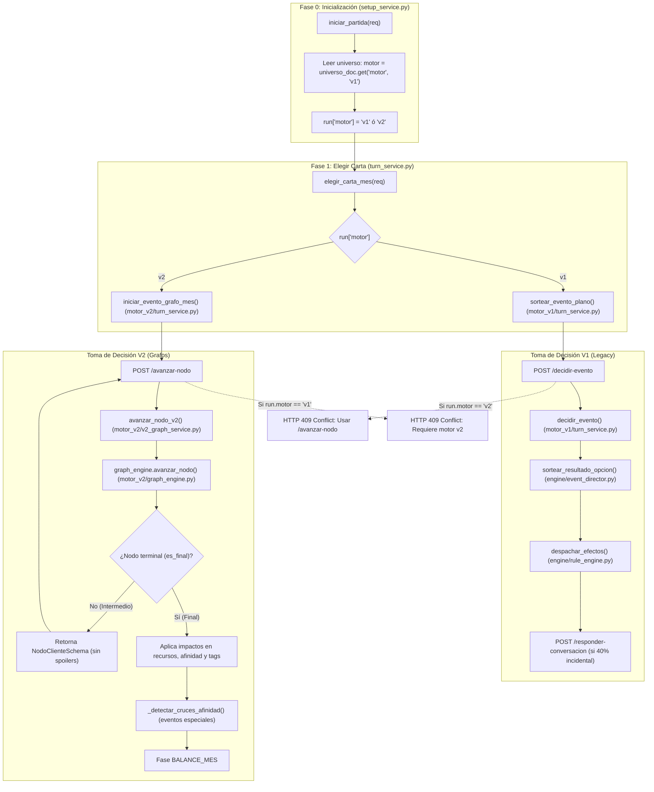

# Informe Técnico: Verificación de Grafos V2 y Función de Decisiones V1

**Rama analizada:** `feature/integracion-con-front`  
**Repositorio:** `juegos-mayores-actualizaciones-back`  
**Fecha:** 2026-11-06  

---

## 1. Resumen Ejecutivo

1. **Grafos V2 (Activo):** El backend contiene la implementación completa del **Motor Narrativo V2 basado en Grafos de Decisión Acíclicos (DAGs / Árboles)**. Cuenta con endpoints de ciclo mensual (`/avanzar-nodo`), motor estocástico sin spoilers (`graph_engine.py`), servicio de orquestación (`v2_graph_service.py`), validadores de topología (`graph_validator.py`), esquemas Pydantic dedicados (`v2_graph_schemas.py`), endpoints CRUD administrativos V2 y suite de pruebas unitarias y de contrato.
2. **Función de Decisión V1 (Legacy / Aislada):** Se localizó la función de toma de decisiones V1 (`sortear_resultado_opcion` en `event_director.py`), así como sus controladores de servicio asociados (`decidir_evento` y `responder_conversacion` en `app/features/narrative/game/motor_v1/turn_service.py`).
3. **Mecanismo de Conmutación (Switching):** La partida adopta el motor definido en el documento del universo (`universo_doc.get("motor", "v1")`). Existen guardas bidireccionales con código de estado HTTP 409 para impedir que un cliente ejecute endpoints V1 en una partida V2 o viceversa.

---

## 2. Verificación de Grafos V2

### 2.1. Colecciones en MongoDB para V2
* `narrative_v2_events`: Grafos de eventos mensuales.
* `narrative_v2_conversations`: Grafos de diálogos entre consejeros de la corte.
* `narrative_v2_eventos_especiales`: Grafos reactivos de eventos de lealtad (afinidad $\ge 95$) o traición (afinidad $\le 15$).
* `narrative_runs`: Partidas activas. Cuando `motor == "v2"`, se mantiene el campo `grafo_activo: { tipo, grafo_id, nodo_actual_id, historial_nodos }`.

### 2.2. Archivos y Carpetas del Motor V2

| Archivo | Carpeta | Responsabilidad |
|---|---|---|
| `graph_engine.py` | `app/features/narrative/game/motor_v2/` | **Núcleo de ejecución de grafos.** Clase `GraphTraversalEngine`. Resuelve navegación paso a paso sin spoilers, cálculo de pesos estocásticos dinámicos (`_pesos_desenlaces`), transiciones de nodo (`avanzar_nodo`), aplicación atómica de consecuencias en recursos y afinidad al llegar a nodos finales (`es_final=True`), y disparo reactivo de eventos especiales (`_detectar_cruces_afinidad`). |
| `v2_graph_service.py` | `app/features/narrative/game/motor_v2/` | **Servicio de orquestación de partidas V2.** Expone `avanzar_nodo_v2`, `obtener_grafo_actual_v2`, `proyectar_grafo_actual`, `iniciar_evento_mes_v2` e `iniciar_conversacion_mes_v2`. Implementa guardas defensivas de estado y fase. |
| `turn_service.py` | `app/features/narrative/game/motor_v2/` | **Fase 1 V2.** `iniciar_evento_grafo_mes`: Sortea un grafo de evento e inicializa su nodo raíz en la partida tras la selección de carta. |
| `v2_graph_schemas.py` | `app/features/narrative/schemas/` | **Contratos de datos V2.** Define `NodoNarrativoSchema`, `OpcionNodoSchema`, `DesenlaceNodoSchema`, `EventoV2GrafoSchema`, `ConversacionV2GrafoSchema`, `EventoEspecialV2GrafoSchema`, `NodoClienteSchema`, `OpcionClienteSchema` y `EstadoGrafoV2Response`. |
| `graph_validator.py` | `app/features/narrative/validation/` | **Validador de grafos.** Chequea alcanzabilidad de nodos desde la raíz, ausencia de ciclos infinitos, existencia de nodos finales, integridad de referencias a personajes/recursos y consistencia de desenlaces. |
| `seed_narrative_v2_graphs.py` | `app/scripts/` | **Script de carga masiva.** Población de grafos V2 en base de datos. |

### 2.3. Endpoints API de Grafos V2

#### En Partida (`app/features/narrative/game/router.py`):
* `POST /api/narrative/v2/partida/avanzar-nodo` $\rightarrow$ Avanza una opción dentro del grafo activo.
* `GET /api/narrative/v2/partida/grafo-actual` $\rightarrow$ Consulta el estado del nodo actual para recargas (F5).
* `POST /api/narrative/v2/partida/iniciar-evento-grafo` $\rightarrow$ Inicia un grafo de evento para el mes.
* `POST /api/narrative/v2/partida/iniciar-conversacion-grafo` $\rightarrow$ Inicia un diálogo en formato grafo.

#### En Administración (`app/features/narrative/admin/router.py`):
* `GET|POST|DELETE /api/narrative/admin/v2/eventos` $\rightarrow$ CRUD de grafos de eventos.
* `GET|POST|DELETE /api/narrative/admin/v2/conversaciones` $\rightarrow$ CRUD de grafos de conversaciones.
* `GET|POST|DELETE /api/narrative/admin/v2/eventos-especiales` $\rightarrow$ CRUD de eventos de afinidad extrema.
* `POST /api/narrative/admin/v2/validar` $\rightarrow$ Validación sintáctica y topológica de grafos.

---

## 3. Verificación de la Función de Decisión V1

### 3.1. Colecciones en MongoDB para V1
* `narrative_events`: Eventos planos de un solo paso.
* `narrative_results`: Desenlaces individuales desacoplados referenciados por ID.
* `narrative_conversations`: Conversaciones de corte tradicionales.

### 3.2. Funciones Centrales de V1 y Conexiones

| Función | Archivo | Conexión / Flujo de Llamadas |
|---|---|---|
| `sortear_resultado_opcion` | `app/features/narrative/engine/event_director.py` (Línea 145) | **Función central de toma de decisiones V1.** Recibe `(opcion_data, run_data)`. Modifica los pesos base según condiciones de cartas y consejeros, ejecuta `random.choices` y retorna directamente el `resultado_id` ganador en una única tirada plana. |
| `calcular_opciones_evento` | `app/features/narrative/engine/event_director.py` (Línea 68) | Calcula las probabilidades y explicaciones expuestas al jugador para cada desenlace posible de la opción. |
| `seleccionar_evento_mes` | `app/features/narrative/engine/event_director.py` (Línea 13) | Sorteo ponderado del evento plano para el mes. |
| `decidir_evento` | `app/features/narrative/game/motor_v1/turn_service.py` (Línea 139) | Controlador de dominio V1. Valida fase `TOMA_DECISION_EVENTO`, llama a `sortear_resultado_opcion`, aplica efectos mediante `rule_engine.despachar_efectos`, actualiza recursos y evalúa si dispara una conversación incidental (40% probabilidad). |
| `responder_conversacion` | `app/features/narrative/game/motor_v1/turn_service.py` (Línea 232) | Resuelve la respuesta elegida en el diálogo plano V1. |
| `sortear_evento_plano` | `app/features/narrative/game/motor_v1/turn_service.py` (Línea 78) | Sortea el evento del mes plano si la partida tiene motor V1. |

### 3.3. Endpoints API Legacy V1 (`app/features/narrative/game/router.py`)
* `POST /api/narrative/v2/partida/decidir-evento` $\rightarrow$ Ejecuta `motor_v1.turn_service.decidir_evento`. *(Marcado como `@deprecated`, responde HTTP 409 si la partida es V2)*.
* `POST /api/narrative/v2/partida/responder-conversacion` $\rightarrow$ Ejecuta `motor_v1.turn_service.responder_conversacion`. *(Marcado como `@deprecated`, responde HTTP 409 si la partida es V2)*.
* `GET /api/narrative/partida/evento-actual` $\rightarrow$ Ejecuta `obtener_evento_actual_partida` (`motor_v1/modals.py`).
* `GET /api/narrative/partida/conversacion-actual` $\rightarrow$ Ejecuta `obtener_conversacion_actual_partida`.
* `GET /api/narrative/partida/resultado-actual` $\rightarrow$ Ejecuta `obtener_resultado_actual_partida`.
* `GET /api/narrative/partida/draft-actual` $\rightarrow$ Ejecuta `obtener_draft_actual_partida`.

---

## 4. Diagrama de Conexiones y Conmutación (V1 vs V2)

---

## 5. Matriz Comparativa Técnica

| Característica | Motor V1 (Plano / Legacy) | Motor V2 (Grafos / Actual) |
|---|---|---|
| **Estructura de Contenido** | Evento plano $\rightarrow$ 3 opciones $\rightarrow$ Desenlace atómico | Árbol/DAG de $N$ nodos con diálogos, opciones intermedias y terminales |
| **Conversaciones** | Disparo probabilístico del 40%, diálogo fijo de 3 opciones | Grafos independientes (`narrative_v2_conversations`) con ramificaciones |
| **Visibilidad de Probabilidades** | Pública: el frontend recibe porcentajes exactos (`probabilidades[]`) | Oculta: anti-spoiler, el frontend solo recibe opciones disponibles |
| **Manejo de Desenlaces** | Documentos externos en `narrative_results` | Desenlaces embebidos en `DesenlaceNodoSchema` o transiciones directas |
| **Eventos Especiales** | No soportados nativamente | Disparo reactivo por afinidad ($\ge 95$ Lealtad, $\le 15$ Traición) |
| **Ubicación en Código** | `app/features/narrative/game/motor_v1/` y `engine/event_director.py` | `app/features/narrative/game/motor_v2/` y `schemas/v2_graph_schemas.py` |
| **Pruebas Automatizadas** | `tests/contract/test_narrative_motor_matrix.py` | `tests/test_narrative_v2_*.py`, `tests/unit/test_narrative_graph_validator.py` |

